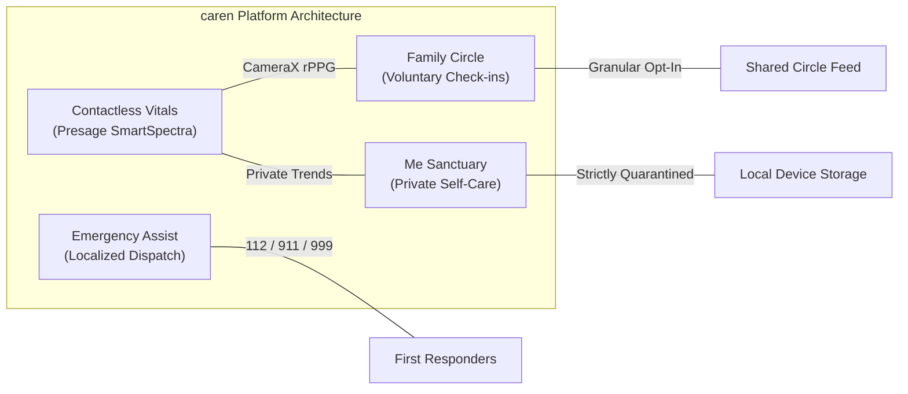
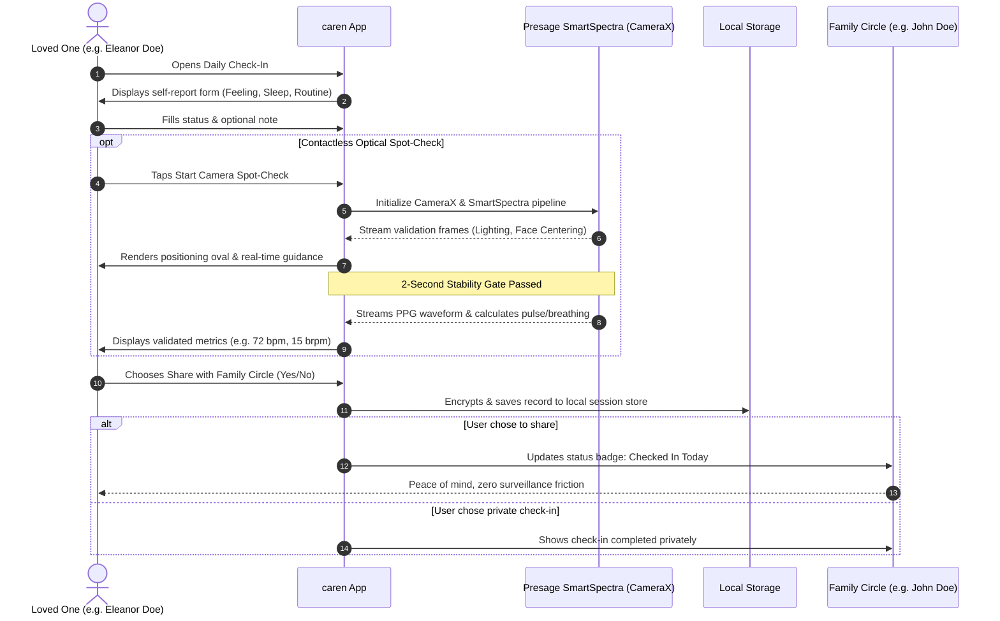
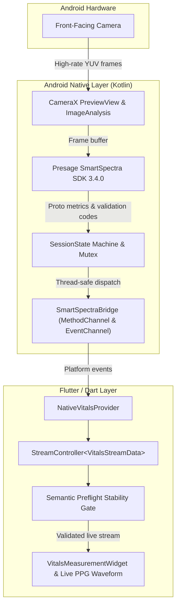
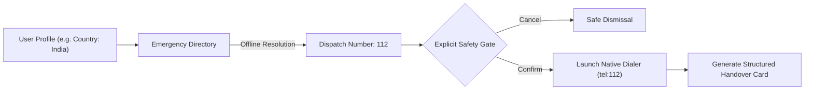

<div align="center">

  

  # caren
  ### Care, closer.

  **An open-source family wellbeing companion and personal sanctuary.**  
  Voluntary daily check-ins, mindful routines, contactless optical vitals, and immediate emergency assist.

  <br/>

  [](LICENSE)
  [](https://flutter.dev)
  [](https://dart.dev)
  [](https://presagetech.com)
  [](https://github.com/slightlybroke/caren)
  [](test/)

  <br/>

  [Try Live Web Demo](https://try-caren.vercel.app) &nbsp;|&nbsp; 
  [Download Android APK (v1.0.0)](https://github.com/slightlybroke/caren/releases/tag/android-demo-v1) &nbsp;|&nbsp; 
  [Architecture Deep Dive](ARCHITECTURE.md) &nbsp;|&nbsp; 
  [Contributing](CONTRIBUTING.md) &nbsp;|&nbsp; 
  [Security & Privacy](SECURITY.md)

</div>

---

## The Problem: The Distance Caregiver Dilemma

Millions of families live across different cities, provinces, and time zones. When supporting aging parents, partners, or loved ones living independently, everyday communication often falls into an uncomfortable dilemma:

1. **The Surveillance Trap:** Asking *"Did you take your pills? What are your vitals today?"* often feels like condescending micro-management or infantilizing surveillance.
2. **The Anxiety Gap:** Staying silent to avoid nag-fatigue leaves family members carrying constant, unaddressed anxiety about whether their loved one is safe.
3. **The Friction of Wearables:** Many elders and independent individuals dislike wearing smartwatches 24/7, forget to charge proprietary health bands, or find clinical monitors intimidating.
4. **The Emergency Confusion:** In a crisis, panicking individuals or caregivers struggle to look up the correct localized emergency dispatch numbers, recall symptoms, or communicate an accurate timeline to paramedics under stress.

caren resolves these tensions through **sovereign consent**, **voluntary sharing**, **contactless camera-based optical vitals**, and **one-tap emergency assistance**.

---

## Core Product Pillars



### 1. Family Circle: Voluntary Reassurance, Zero Surveillance
Family members check in voluntarily on their own schedule. A check-in captures self-reported energy, sleep quality, daily routine completion, and personal notes.
- **Granular Sovereignty:** Every check-in carries an explicit toggle (`Share with Family Circle`). Users can share their status while keeping personal reflections completely private.
- **Gentle Reassurance:** Family dashboards display reassuring status badges (`Checked In`, `Pending Today`) without telemetry, location tracking, or intrusive notifications.

### 2. Me Sanctuary: Quarantined Personal Mindfulness
A completely isolated, confidential space for guided breathing and grounding exercises.
- **Guided Paced Breathing:** Rhythmic expanding and contracting pacing animations (4s inhale / 6s exhale) with optional spoken audio guidance and mute toggles.
- **Sensory Grounding (5 Senses):** Cognitive grounding routines designed to reduce acute stress through step-by-step sensory anchoring.
- **Strict Quarantine:** Data created in the Me Sanctuary is never uploaded to the family feed or accessible to circle members.

### 3. Contactless Vitals via Presage SmartSpectra
Integrated with the **Presage SmartSpectra SDK (3.4.0)** on Android, turning the front-facing camera into an optical pulse and respiration sensor using remote photoplethysmography (rPPG).
- No wearables or external accessories required.
- **Intelligent Preflight Gate:** Automatic illumination checks and face centering guides enforce a 2-second stability window before measurement begins, preventing inaccurate readings.
- **Live Photoplethysmogram (PPG) Waveform:** Real-time visual pulse waveforms reassure the user that optical signal capture is actively functioning.

### 4. Emergency Assist: Instant Localized Dispatch & Medical Handover
- **Localized Dispatch Resolution:** Automatically resolves national emergency numbers (e.g., `112` for Europe/India, `911` for US/Canada, `999` for UK) based on the user's configured country without external network round-trips.
- **Explicit Safety Confirmation:** Two-step confirmation prevents accidental dialer launches.
- **Structured Handover Timeline:** Consolidates timestamps, symptoms, and user notes into a concise clinical summary that paramedics or hospital staff can read or copy in one tap.

---

## User Journey & Consent Flow

The following sequence illustrates how caren balances family transparency with individual privacy during a daily check-in:



---

## Optical Sensing Architecture (Presage SmartSpectra 3.4.0)

caren bridges the official Presage SmartSpectra Android SDK via high-performance platform channels, decoupling the native frame processing pipeline from Flutter UI rendering:



### Native SmartSpectra Kotlin Bridge Snippet
The native bridge manages single-owner measurement sessions with mutex concurrency control and zero background telemetry:

```kotlin
// android/app/src/main/kotlin/com/caren/app/caren/smartspectra/SmartSpectraBridge.kt
class SmartSpectraBridge(
    private val activity: Activity,
    messenger: BinaryMessenger
) : MethodChannel.MethodCallHandler, EventChannel.StreamHandler {

    private val methodChannel = MethodChannel(messenger, "com.caren.app/smartspectra")
    private val eventChannel = EventChannel(messenger, "com.caren.app/smartspectra_stream")
    private val sessionMutex = Mutex()
    private var sessionState = SessionState.UNINITIALIZED

    suspend fun startMeasurement(sessionId: String, targetDuration: Int): Boolean {
        sessionMutex.withLock {
            if (sessionState == SessionState.ACTIVE) return false
            sessionState = SessionState.STARTING

            val config = SmartSpectraConfig(
                apiKey = getApiKey(),
                camera = CameraSelection.FRONT,
                sendTelemetry = false // Sovereign privacy: zero telemetry
            )

            SmartSpectraSdk.start(
                config = config,
                onMetrics = { metrics: Metrics ->
                    val payload = mapOf(
                        "pulse" to metrics.pulseBpm,
                        "breathing" to metrics.respirationBpm,
                        "waveform" to metrics.waveformValue,
                        "confidence" to metrics.confidenceScore,
                        "validationCode" to metrics.validationCode.name
                    )
                    eventSink?.success(payload)
                },
                onError = { error -> handleFailure(error) }
            )
            sessionState = SessionState.ACTIVE
            return true
        }
    }
}
```

### Dart EventChannel Subscription & Real-Time Waveform
The Flutter layer subscribes to the stream and feeds the live PPG waveform into the UI:

```dart
// lib/services/vitals/native_vitals_provider.dart
class NativeVitalsProvider implements VitalsProvider {
  static const MethodChannel _methodChannel = MethodChannel('com.caren.app/smartspectra');
  static const EventChannel _eventChannel = EventChannel('com.caren.app/smartspectra_stream');

  Stream<VitalsStreamData> startMeasurement({MeasurementConfig config = const MeasurementConfig()}) {
    _streamController = StreamController<VitalsStreamData>.broadcast();

    _methodChannel.invokeMethod('startMeasurement', {
      'targetSeconds': config.target.defaultDurationSeconds,
    });

    _eventSubscription = _eventChannel.receiveBroadcastStream().listen((dynamic raw) {
      final map = Map<String, dynamic>.from(raw as Map);
      final data = VitalsStreamData(
        status: MeasurementStatus.measuring,
        instantaneousPulse: (map['pulse'] as num?)?.toDouble(),
        instantaneousBreathing: (map['breathing'] as num?)?.toDouble(),
        waveformValue: (map['waveform'] as num?)?.toDouble(),
        confidenceScore: (map['confidence'] as num?)?.toDouble(),
        validationCode: map['validationCode'] as String? ?? 'OK',
      );
      _streamController?.add(data);
    });

    return _streamController!.stream;
  }
}
```

---

## Emergency Assist: Localized Dispatch Architecture

In a health crisis, expecting an individual or caregiver to search online for local emergency numbers is dangerous. caren resolves dispatch numbers synchronously from a localized directory without requiring internet access or active SIM geolocation:



### Emergency Handover Timeline Synthesis
caren automatically consolidates user observations, symptoms, and elapsed time into an exportable medical summary:

```dart
// lib/features/emergency/presentation/emergency_session_screen.dart
String _generateHandoffSummaryText() {
  final buffer = StringBuffer();
  buffer.writeln('CAREN MEDICAL HANDOVER SUMMARY');
  buffer.writeln('Session Started: ${AppFormatters.formatDateTime(_session!.startTime)}');
  buffer.writeln('Country Dispatch: ${userProfile.country} (${userProfile.emergencyNumber})');
  buffer.writeln('----------------------------------------');
  buffer.writeln('OBSERVATIONS & TIMELINE:');
  for (final obs in _session!.observations) {
    buffer.writeln('• [${AppFormatters.formatTime(obs.timestamp)}] ${obs.description}');
  }
  if (_consentMeasurement != null) {
    buffer.writeln('----------------------------------------');
    buffer.writeln('LAST OPTICAL SPOT-CHECK:');
    buffer.writeln('Pulse: ${_consentMeasurement!.pulseRateBpm?.toInt() ?? "--"} bpm');
    buffer.writeln('Breathing: ${_consentMeasurement!.breathingRateBpm?.toInt() ?? "--"} brpm');
    buffer.writeln('Quality: ${(_consentMeasurement!.qualityScore * 100).toInt()}%');
  }
  return buffer.toString();
}
```

---

## Quickstart & Developer Onboarding

### 1. Prerequisites
- [Flutter SDK](https://flutter.dev/docs/get-started/install) (`>= 3.13.0`, tested on Flutter 3.47.5 stable)
- [Dart SDK](https://dart.dev/get-dart) (`>= 3.13.0`)
- Android Studio / VS Code with Flutter extension
- An Android device running Android 9+ (API 28+) for native optical camera vitals, or any modern web browser for the web demo

### 2. Clone & Run (Web Explorer)
```sh
git clone https://github.com/slightlybroke/caren.git
cd caren
flutter pub get
flutter run -d chrome
```
*Click **"Explore the Live Demo"** on the landing page to instantly sign in as **John Doe** and explore the pre-seeded Family Circle.*

### 3. Run on Physical Android Hardware
```sh
flutter devices
flutter run -d <device-id>
```

### 4. Enable Live Presage SmartSpectra Readings
The public demo uses simulated vitals when an API key is not present. To activate live camera readings on physical hardware:
1. Obtain an authorized key from the [Presage Developer Portal](https://physiology.presagetech.com).
2. Add your key to `android/local.properties`:
   ```properties
   SMARTSPECTRA_API_KEY=your_presage_api_key_here
   ```
3. Re-launch `flutter run -d <device-id>`. The app will stream live CameraX frames to the native SDK pipeline.

### 5. Optional: Connect Custom Firebase Project
caren operates completely standalone using local in-memory repositories by default. To connect your own live Firebase backend:
1. Create a Firebase project with Email/Password Auth and Cloud Firestore.
2. Register the Android package `com.caren.app.caren`.
3. Place `google-services.json` in `android/app/`.
4. Deploy the checked-in Firestore rules:
   ```sh
   firebase deploy --only firestore:rules,firestore:indexes
   ```

---

## Testing & Quality Verification

caren includes a comprehensive test suite across unit, widget, and authorization layers:

```sh
# 1. Run static analysis (0 warnings, 0 errors)
flutter analyze

# 2. Run unit and widget test suite (116 tests passing)
flutter test

# 3. Test Cloud Firestore Security Rules in local emulator
npm ci --prefix firestore-rules-tests
firebase emulators:exec --only firestore "npm --prefix firestore-rules-tests test"
```

---

## Security & Privacy Policy

- **No Passive Tracking:** caren never operates camera, microphone, or location sensors in the background.
- **On-Device Frame Processing:** When performing a wellness check, CameraX frames are processed in-memory by SmartSpectra; video streams are never written to disk or uploaded to remote cloud storage.
- **Strict Consent Boundary:** Personal mindfulness routines in the Me Sanctuary are quarantined on-device and never shared across family feeds.
- **Non-Clinical Notice:** caren’s optical estimates are for personal wellness tracking and family reassurance. They do not constitute diagnostic medical evaluations.

For full disclosure details, review [SECURITY.md](SECURITY.md).

---

## Contributing & Community

Contributions are welcome! Please read [CONTRIBUTING.md](CONTRIBUTING.md) and review our [Code of Conduct](CODE_OF_CONDUCT.md) before opening a pull request.

---

## License

caren is open-source software licensed under the [MIT License](LICENSE).  
The Presage SmartSpectra SDK is provided by [Presage Technologies](https://presagetech.com) under separate developer terms.
